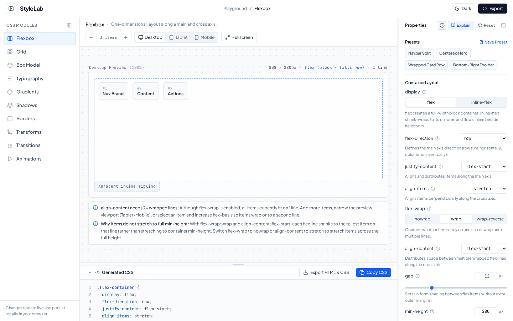
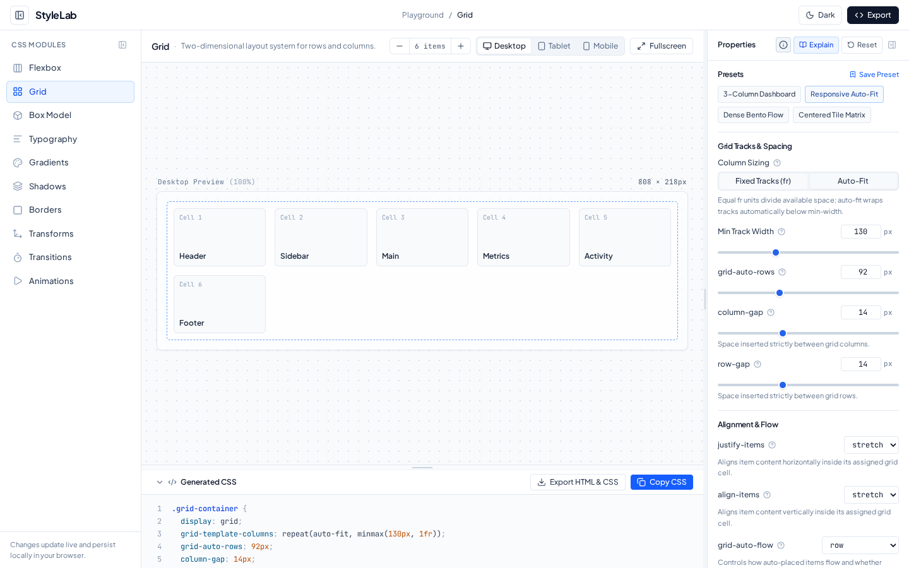
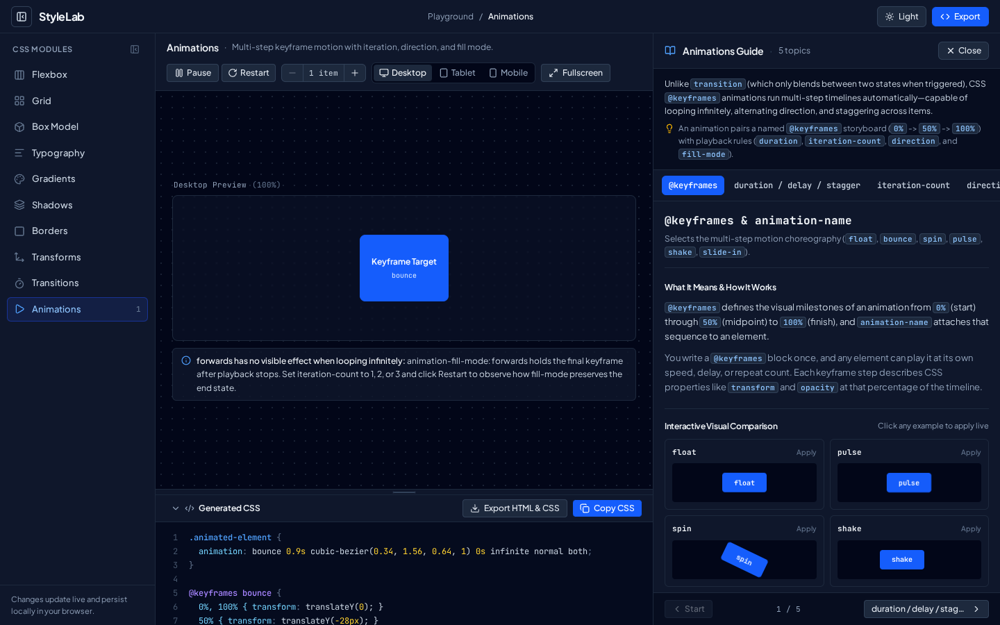

# StyleLab — Interactive CSS Playground

StyleLab is a client-side developer tool for experimenting with modern CSS properties through interactive controls, real-time browser rendering, syntax-highlighted code generation, and beginner-friendly visual guides.

---

## Screenshots

### Flexbox Workspace (Light Theme)


### CSS Grid Responsive Auto-Fit


### Interactive Learning Guide (Dark Theme)


---

## Features

- **10 Interactive CSS Playgrounds**:
  - **Flexbox**: Container layout (`display: flex` vs `inline-flex` with adjacent inline flow sibling, `flex-direction`, `justify-content`, `align-items`, `flex-wrap`, `align-content`, `gap`, `min-height`) and per-item overrides (`flex-grow`, `flex-shrink`, `flex-basis`, `align-self`, `order`).
  - **Grid**: Fixed `fr` tracks and `auto-fit` `minmax()` columns, `grid-auto-rows`, column/row gaps, `justify-items`, `align-items`, `grid-auto-flow`, and per-cell `grid-column` / `grid-row` spans.
  - **Box Model**: `box-sizing` (`border-box` vs `content-box`), dimensions, linked or split padding and margins, and border styling with live border-box and content-box pixel readouts.
  - **Typography**: Font families (`Plus Jakarta Sans`, `Georgia`, `JetBrains Mono`, system sans), size, weight (`300–800`), unitless line-height, letter-spacing (`em`), alignment, text-transform, text-decoration, `ch` measure, and live editable preview text.
  - **Gradients**: Multi-stop `linear-gradient`, `radial-gradient`, and `conic-gradient` builder with angle, shape, position, and dynamic color stops.
  - **Shadows**: Multi-layered `box-shadow` composer with X/Y offsets, blur, spread, color, opacity, and `inset` toggle.
  - **Borders**: Border width, stroke styles (`solid`, `dashed`, `dotted`, `double`, `groove`, `ridge`), linked or independent corner radii, and non-layout-shifting `outline` + `outline-offset`.
  - **Transforms**: 2D & 3D `translate`, `rotate`, `scale`, `skew`, `perspective`, `rotateX`, `rotateY`, and `transform-origin` against an untransformed ghost reference box.
  - **Transitions**: Interactive hover/click transition tester with `transition-property`, duration, cubic-bezier / easing curves, delay, and customizable hover target states.
  - **Animations**: Multi-step `@keyframes` choreography (`float`, `bounce`, `pulse`, `spin`, `shake`, `slide-in`) with duration, easing, delay, iteration count, direction, fill mode, per-item stagger, and play/pause/restart controls.
- **Contextual Behavior Diagnostics**: Explains in real time why certain properties have no visible effect under current layout conditions (e.g., `align-content` on a single-line `nowrap` container or `perspective` without 3D rotation).
- **Detailed Learning Panel (`Explain`)**: Side-by-side beginner-friendly guides for every module and property, featuring interactive visual comparisons, value breakdowns, real-world examples, common mistakes, and one-click **Apply to Playground**.
- **Developer Workspace Ergonomics**:
  - Three-panel layout with collapsible CSS module navigation, resizable/collapsible **Generated CSS** panel, and resizable/collapsible **Properties** panel.
  - **Desktop (`100%`)**, **Tablet (`768px`)**, and **Mobile (`375px`)** preview frames.
  - Native browser **Fullscreen** mode (`Esc` to exit) preserving all edits and settings.
  - Light & Dark themes persisted in `localStorage`.
- **Presets & Safe Code Export**:
  - Built-in practical presets plus custom user presets saved in `localStorage`.
  - Instant one-click **Copy CSS** and standalone **HTML + CSS** / **CSS Only** export with file download (`.html` / `.css`) and HTML-escaped user text.

---

## Technology Stack

- **UI Library**: React 19 (JavaScript, functional components & hooks)
- **Styling**: Tailwind CSS v4 (`@tailwindcss/vite`)
- **Icons**: Lucide React
- **Build Tool**: Vite 8
- **Persistence**: Browser `localStorage` (no backend, database, or external APIs)
- **Testing**: Node.js built-in test runner (`node:test`)

---

## Installation

### Prerequisites

- **Node.js** `>= 20` (tested on Node `22.x`)
- **npm** `>= 10`

### Setup

```bash
# 1. Install dependencies
npm install

# 2. Start the development server on http://localhost:3000
npm run dev
```

### Available Scripts

| Script | Command | Description |
| --- | --- | --- |
| `npm run dev` | `vite --port=3000 --host=0.0.0.0` | Runs the local Vite dev server on port `3000`. |
| `npm test` | `node --test src/utils/*.test.js` | Runs the unit test suite for CSS generation, escaping, diagnostics, highlighting, guides, and storage. |
| `npm run build` | `vite build` | Creates the production bundle in `dist/`. |
| `npm run preview` | `vite preview` | Previews the production build locally. |
| `npm run lint` | `tsc --noEmit` | Runs static type/syntax checks across JS/JSX files. |

---

## Usage Instructions

1. **Choose a CSS Module**: Pick any of the 10 playgrounds from the left sidebar (`Flexbox` through `Animations`).
2. **Experiment with Controls**: Adjust sliders, numeric inputs, dropdowns, toggles, and color pickers in the right **Properties** panel. For **Flexbox** and **Grid**, click individual items/cells inside the preview to configure per-item properties (`flex-grow`, `flex-basis`, `col-span`, etc.).
3. **Add/Remove Elements & Switch Viewports**: Use the `- / +` item stepper and **Desktop / Tablet / Mobile** toggles in the preview toolbar to test responsive wrapping and overflow.
4. **Learn Properties in Depth**: Click **Explain** (or the `?` icon next to any property) to open the interactive learning guide and apply examples directly to the live canvas.
5. **Save Presets & Export Code**: Save custom configurations under **Presets**, copy syntax-highlighted CSS from the bottom **Generated CSS** panel, or click **Export** to download a standalone `.html` or `.css` file.
